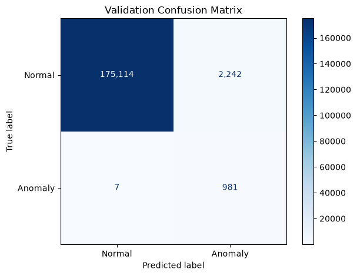
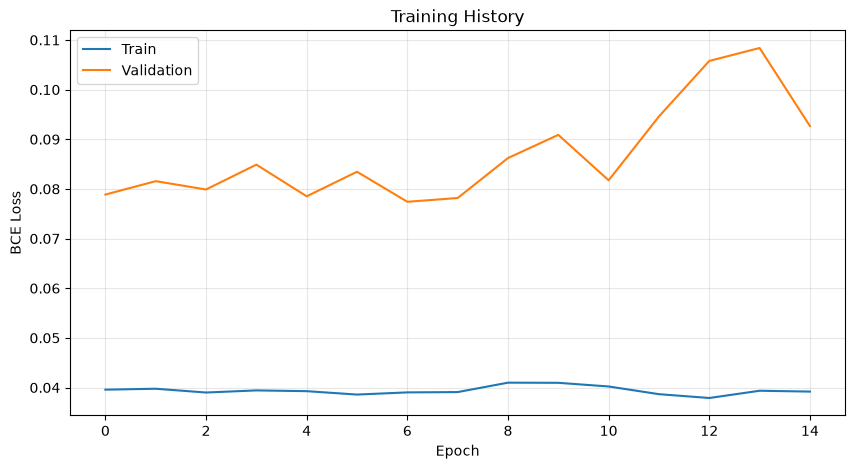

# LSTM 기반 금융 이상거래 탐지

출금계좌별 거래 이력을 시퀀스로 구성하고, 최근 거래 흐름을 바탕으로 현재 거래의 이상 여부를 분류한 프로젝트입니다. 주가·전력 사용량 예측에서 익힌 RNN/LSTM을 금융거래의 지도학습 이진 분류로 확장했습니다.

**저장된 Validation 결과에서 이상 거래 988건 중 981건을 탐지했습니다(Recall 99.29%). 다만 오탐 2,242건, Precision 30.44%로 오탐 감소가 주요 과제로 남았습니다.** 아래 수치는 독립 Test 성능이 아닌 노트북에 저장된 검증 실행 결과입니다.

## 1. 사용한 기술스택

| 구분 | 기술 및 활용 |
|---|---|
| 개발 환경 | Python, Jupyter Notebook |
| 데이터 처리 | pandas, NumPy, Python `csv`, `pathlib`, `unicodedata` |
| 딥러닝 | PyTorch의 LSTM, Dataset, DataLoader |
| 전처리·평가 | scikit-learn의 StandardScaler, classification_report, confusion_matrix |
| 시각화 | Matplotlib: 거래금액 분포, 학습 곡선, 혼동행렬 |
| 실행 장치 | 저장된 실행 로그 기준 Apple Silicon MPS; 코드에서 CUDA·MPS·XPU·CPU 선택 |

주요 구현은 [LSTM 과제.ipynb](LSTM%20과제.ipynb)에 있습니다.

## 2. 데이터 전처리 과정

### 데이터 구성과 탐색

사용한 데이터셋의 폴더명은 **「이상 판별을 위한 금융거래 정보 및 사용자 패턴 합성데이터」**입니다. 전자금융공동망과 카드거래 CSV를 병합했으며, 모델 학습에는 전자금융공동망 데이터를 사용했습니다. 합성데이터를 사용한 실험이므로 실제 금융 서비스 성능으로 일반화하지 않습니다.

| 전자금융공동망 데이터 | 원본 거래 행 수 | 생성된 길이 20 시퀀스 수 |
|---|---:|---:|
| Training | 3,941,428 | 3,417,274 |
| Validation | 492,678 | 178,344 |

1. **CSV 병합:** Training·Validation과 거래 종류를 중첩 `for`문으로 순회했습니다. 헤더는 한 번만 기록하고, 컬럼 일치 여부를 검사하며 행 단위로 저장하도록 구현했습니다. 한글 폴더명의 유니코드 정규화도 고려했습니다.
2. **구조 확인:** `head()`, `info()`와 입금계좌번호 중복 집계로 데이터 구조를 확인했습니다. 같은 계좌의 반복 등장은 거래 이력일 수 있으므로 계좌번호 중복만으로 행을 삭제하지 않았습니다.
3. **정렬·그룹화:** 출금계좌별로 묶고 `거래일자 → 거래시간대` 오름차순으로 정렬했습니다. 같은 날짜·시간대에서는 원래 행 순서를 유지했습니다. 날짜만 사용하는 정렬 결과도 비교용으로 구성했습니다.
4. **특징 생성:** 현재 거래를 제외한 이전 최대 20건의 평균 금액을 `shift(1)`과 `rolling()`으로 계산했습니다. 시간대는 23시와 0시의 인접성을 표현하도록 sin/cos로 변환했습니다.
5. **스케일링:** StandardScaler는 Training에서만 `fit`하고, 같은 기준으로 Training과 Validation을 변환했습니다. 정답 라벨은 정상 0, 이상 1로 유지했습니다.
6. **시퀀스 구성:** 계좌마다 이전 19건과 현재 거래 1건을 묶어 현재 거래의 이상 여부를 예측했습니다. 서로 다른 계좌의 거래가 하나의 시퀀스에 섞이지 않도록 구성했습니다.

| 모델 입력 특징 | 의미 |
|---|---|
| 거래금액 | 현재 거래의 금액 |
| 이전평균대비금액 | 현재 금액 / 같은 계좌의 이전 최대 20건 평균 금액 |
| 시간_sin, 시간_cos | 거래시간대의 순환 특성 |

이전 평균이 없거나 0이면 금액 비율은 0으로 채웠습니다. 계좌번호는 그룹 구분에만 사용하고, `이상거래여부`, `이상거래유형`, `이상거래설명`은 입력에서 제외했습니다.

```text
같은 출금계좌의 거래 1~20 → 거래 20의 정상·이상 여부
같은 출금계좌의 거래 2~21 → 거래 21의 정상·이상 여부

입력 배치: [batch, 20, 4]
정답 배치: [batch, 1]
```

거래 20건은 고정된 20시간·20일을 뜻하지 않습니다. 거래가 20건 미만인 계좌와 각 계좌의 첫 19건은 평가 대상에서 제외됩니다. 현재 Validation 평가 범위는 원본 거래의 약 36.20%입니다.

### 모델과 학습 구성

| 항목 | 현재 노트북 코드 |
|---|---|
| 모델 | LSTM 1층, hidden size 32 → Linear(32, 1) |
| 입력 길이 / 특징 수 | 20 / 4 |
| 배치 크기 | 64 |
| 손실함수 | BCEWithLogitsLoss |
| 옵티마이저 | AdamW, learning rate 0.001, weight decay 0.0001 |
| 학습 제어 | 최대 20 epoch, patience 8, gradient clipping 1.0 |
| 예측 | logit에 Sigmoid 적용 후 기준값 0.5로 분류 |

Train DataLoader는 완성된 시퀀스의 순서만 섞고, 시퀀스 내부 거래 순서는 유지합니다. 검증 손실이 가장 낮은 가중치를 복원한 뒤 평가하도록 구현했습니다.

## 3. 성능

### Validation 실행 결과

노트북에 저장된 출력 기준이며, 재학습이나 독립 Test 평가를 새로 수행한 수치는 아닙니다. 모델·특징 변경 전후를 동일 조건으로 비교한 실험표는 아직 없어 개선 폭은 주장하지 않습니다.

| 지표 | 결과 |
|---|---:|
| 이상 거래 Precision | 30.44% |
| 이상 거래 Recall | 99.29% |
| 이상 거래 F1-score | 0.4659 |
| 전체 Accuracy | 98.74% |
| 정상 거래 오탐률: FP / (TN + FP) | 1.26% |
| 최소 Validation Loss | 0.077411: epoch 7 |
| 학습 종료 | epoch 15: Early Stopping |

| 실제 / 예측 | 정상 예측 | 이상 예측 |
|---|---:|---:|
| 실제 정상 | TN 175,114 | FP 2,242 |
| 실제 이상 | FN 7 | TP 981 |



이상 거래 988건 중 981건을 찾았지만, 이상으로 분류한 3,223건 중 2,242건은 정상 거래였습니다. 따라서 **높은 탐지율과 낮은 경보 정확도가 함께 나타난 결과**입니다. 정상 비중이 큰 검증 데이터에서 모두 정상으로 예측해도 Accuracy는 약 99.45%이므로, 정확도만으로 성능을 설명하지 않았습니다.



검증 손실은 epoch 7에서 가장 낮았고 이후 개선되지 않아 조기 종료되었습니다. 낮은 loss가 낮은 오탐을 보장하지 않는다는 점을 혼동행렬과 클래스별 지표로 확인했습니다.

## 4. 트러블슈팅 및 개선점

### 문제 → 대응 → 배운 점

| 문제 | 수행한 대응 | 결과 및 해석 |
|---|---|---|
| 연속값 예측 코드를 분류 과제에 적용 | MSE 기반 회귀 구조를 BCEWithLogitsLoss 기반 분류로 변경하고, 예측 시 Sigmoid 적용 | 금액 자체가 아닌 이상 여부를 예측하는 문제에 맞게 학습·평가 체계를 구성 |
| 전체 거래를 순서대로 자르면 계좌가 섞임 | 출금계좌별 그룹 내부에서만 슬라이딩 윈도 생성 | 하나의 시퀀스가 한 계좌의 이력을 표현하도록 구성 |
| 금액·시간대 두 특징만으로 계좌의 평소 패턴 표현이 제한됨 | 이전 평균 대비 금액과 시간대 sin/cos 특징 추가 | 과거 대비 변화와 시간의 순환성을 입력에 반영; 개별 특징의 성능 기여는 추가 검증 필요 |
| 클래스 불균형과 다수의 오탐 | 클래스 수를 집계하고 pos_weight 및 분류 기준값 조정 방법 검토 | 학습 시퀀스의 이상 비율은 약 0.367%; 가중치·기준값에 따른 Precision–Recall 균형을 별도 비교해야 함 |
| Early Stopping의 break 들여쓰기 오류 | 개선이 없을 때만 종료하도록 수정하고 최적 가중치 복원 | 첫 epoch 종료 오류를 해결하고 최저 검증 손실 모델을 선택하도록 구성 |
| 변수 미정의와 실행 순서 의존 | DataLoader 반복문에서 입력 배치를 꺼내 전체 Validation 예측 | 마지막 배치만 평가하는 방식과 전체 검증 평가를 구분 |

### 재현성과 평가의 한계

- **가중치 설정 덮어쓰기:** `pos_weight ≈ 135.58`을 설정하는 셀 다음에 `criterion = nn.BCEWithLogitsLoss()`가 다시 등장합니다. 위에서부터 실행하면 가중치가 해제되므로 저장된 지표를 가중치 조절의 효과라고 단정할 수 없습니다. 설정 셀을 단일화하고 새 커널에서 재실행하는 것이 우선입니다.
- **실행 상태 추적:** 저장된 셀 출력은 실행 당시의 기록이며 현재 코드와 동일 조건의 재실행을 보장하지 않습니다. 시드 설정만으로 모든 장치에서 완전한 결정성이 보장되지는 않습니다.
- **독립 Test 부재:** 현재 Validation은 모델 조정과 평가에 함께 사용했습니다. 최종 일반화 성능은 아직 확인하지 않았습니다.
- **시간 정보의 해상도:** 같은 날짜·시간대의 정확한 선후관계는 알 수 없습니다. 새벽 거래는 관측할 수 있지만 별도 접속 로그 없이 새벽 접속을 판단할 수는 없습니다.
- **범위 제한:** 거래 이력이 짧은 계좌는 제외되며, 합성데이터 결과를 실제 금융거래 전체의 성능으로 해석할 수 없습니다.

### 다음 개선 실험

1. 실행 설정과 실험 로그를 단일화하고, 모델·옵티마이저를 초기화한 조건에서 재학습합니다.
2. 원본 분할의 날짜 겹침과 중복 거래를 점검합니다. 미래 거래 평가 목적에 맞게 공통 날짜 경계로 Train·Validation·Test를 분리하고, 시퀀스의 마지막 거래 시점으로 소속을 정합니다. 입력은 해당 시점까지의 이력만 사용합니다.
3. Validation에서 요구 Recall을 먼저 정하고 그 조건에서 오탐을 줄이는 기준값을 선택합니다. 선택 후 고정한 기준값을 미사용 Test에 적용합니다.
4. 클래스 가중치, 특징 추가, 시퀀스 길이를 하나씩 바꿔 Precision·Recall·F1·PR-AUC·오탐 건수와 평가 범위를 비교합니다.
5. 거래 한 건만 사용하는 기준 모델과 LSTM을 비교해 과거 이력의 추가 가치를 검증합니다.
6. 필요한 구간만 읽는 Dataset으로 시퀀스 배열 전체 복사를 줄이고, 거래가 적은 계좌의 별도 처리 방법을 검토합니다.
